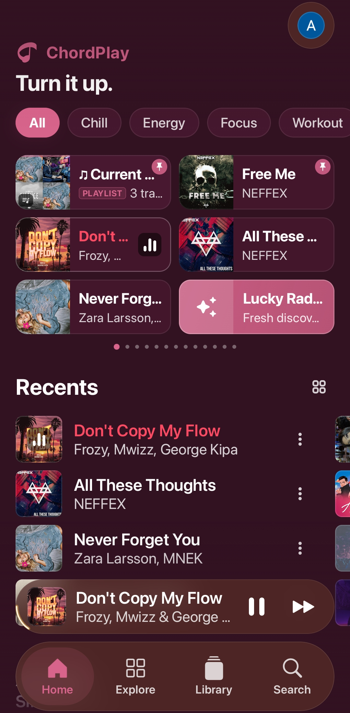
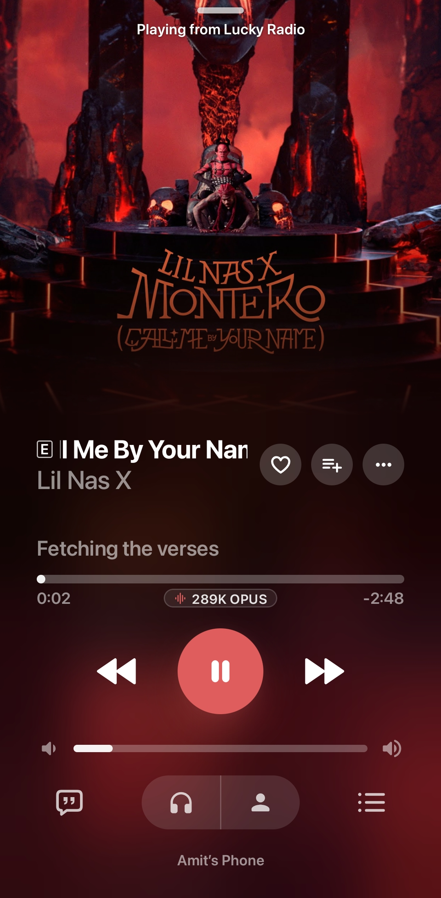
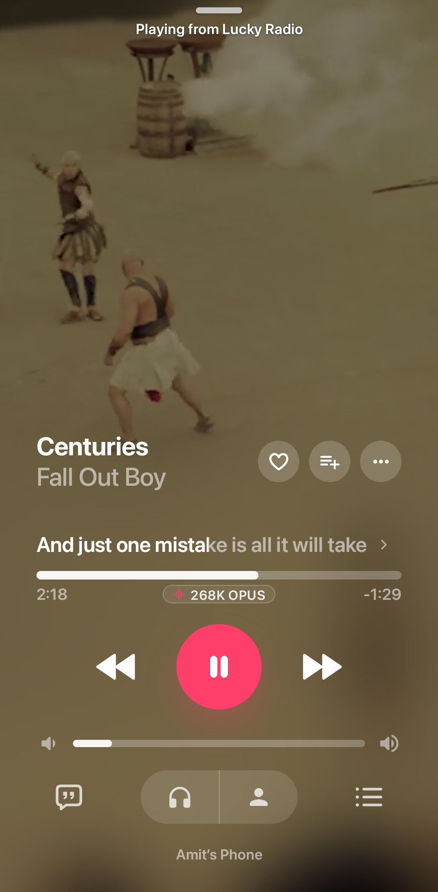

<div align="center">


# PivMusic

**A modern, customizable YouTube Music client for Android.**

<br/>

[](LICENSE)
[](https://www.android.com/)
[](https://kotlinlang.org/)
[](https://github.com/mpx4/PivMusic/releases)

<br/>

[Overview](#overview) • [Features](#features) • [Lyrics](#lyrics) • [Integrations](#integrations) • [Download](#download) • [Build](#build-from-source) • [Credits](#credits) • [License](#license)

</div>

---

## Overview

PivMusic is an independent music player and YouTube Music client for Android. It combines online discovery, local playback, synchronized lyrics, downloads, playlists, audio controls and a highly customizable interface in one application.

The PivMusic fork is maintained by **Yan / mpx4** and is based on ChordPlay, which in turn is based on BitChord. PivMusic is not affiliated with Google, YouTube, Discord or any of the services it integrates with.

> **Package name:** `com.music.piv.lol`
>
> **Current application version:** `2.0.10`

PivMusic is intended for personal and educational use. The availability of online features depends on the corresponding service, network connection and account status.

## Screenshots

<div align="center">
  <table>
    <tr>
      <td align="center" width="25%"><b>Home</b></td>
      <td align="center" width="25%"><b>Discovery</b></td>
      <td align="center" width="25%"><b>Player</b></td>
      <td align="center" width="25%"><b>Lyrics</b></td>
    </tr>
    <tr>
      <td valign="top"></td>
      <td valign="top"></td>
      <td valign="top"></td>
      <td valign="top"></td>
    </tr>
  </table>
</div>

## Features

### Music discovery and library

- Search and browse music from YouTube Music.
- Home recommendations, history, liked music and playlists.
- Local library for downloaded and on-device tracks.
- Queue management, shuffle, repeat, autoplay and playback history.
- Playlist creation, editing, batch actions and swipe actions.
- Spotify playlist import support where available.

### Player and audio

- Modern player interface with album artwork, dynamic colors and multiple player styles.
- Gapless playback and crossfade support.
- Playback speed control and lyrics offset adjustment.
- Audio quality and stream information when available.
- Equalizer and audio-effect controls provided by the device and the application.
- Android media notification, lock-screen controls, widgets and Android Auto support.
- Offline downloads with artwork and metadata handling.
- Support for local audio files and network sources supported by the application.

### Themes and customization

- PivMusic visual identity with dark and OLED-friendly interfaces.
- Dynamic artwork-based colors.
- Custom palettes, typography and player presentation options.
- Material You support where provided by Android.
- Configurable gestures and playback controls.
- Responsive layouts for phones and larger screens.

## Lyrics

PivMusic supports synchronized lyrics from configured online sources and local editing.

- Line-synchronized and word-synchronized lyric display when available.
- Lyrics offset adjustment for tracks whose timing needs correction.
- Online translation while an internet connection is available.
- Local, line-by-line translations that remain available offline.
- A local lyrics editor for replacing or correcting lyrics.
- Local lyrics and translations are stored per track and can be used with downloaded music.
- Translation display follows the selected priority between online results and saved local content.

Lyrics availability and accuracy depend on the source and the metadata associated with the track.

## Integrations

PivMusic includes optional integrations that can be enabled in the application settings:

- YouTube Music account and profile/channel selection.
- Discord Rich Presence.
- Last.fm and ListenBrainz scrobbling.
- Listen Together sessions.
- Spotify playlist import.
- Chromecast and Google Cast playback where supported by the device.

Some integrations require an account, an internet connection or additional configuration. Discord Rich Presence uses the account connection configured inside the application; review the in-app warning before enabling it.

## Privacy and permissions

PivMusic does not require an account to play local files. Online features may require network access and, depending on the feature, a connected service account.

The application may request permissions needed for audio playback, notifications, media access, downloads, casting and Android Auto. Credentials and local settings should be treated as private. Do not share exported logs containing account information or tokens.

## Download

Download the latest APK from the [PivMusic Releases](https://github.com/mpx4/PivMusic/releases) page when a public release is available.

| APK | ABI | Recommendation |
|---|---|---|
| Universal APK | `arm64-v8a`, `armeabi-v7a`, `x86_64` | Recommended for most devices |
| ARM64 APK | `arm64-v8a` | Smaller package for modern 64-bit phones |

PivMusic includes an in-app update checker. Once a compatible GitHub release is published, the application can notify the user about a newer version and offer the update flow from inside the app.

> APKs must be signed with the same signing key to update an existing installation. Keep the release keystore private and backed up.

## Build from source

### Requirements

- JDK 21
- Android SDK with platform 37
- Android NDK and CMake versions required by `app/build.gradle.kts`
- A configured Android SDK path in `local.properties`, `ANDROID_HOME` or `ANDROID_SDK_ROOT`

Clone the repository and build the production release APK:

```bash
git clone https://github.com/mpx4/PivMusic.git
cd PivMusic
./gradlew :app:assembleProdRelease
```

The generated APKs are placed under:

```text
app/build/outputs/apk/prod/release/
```

For a debug build:

```bash
./gradlew :app:assembleProdDebug
```

Release signing is optional for a local build. To create an installable production update, configure a private `keystore.properties` file based on [`keystore.properties.example`](keystore.properties.example). Never commit the keystore or its passwords.

### Configuration

Some optional features read local build configuration from `local.properties` or environment variables, including Last.fm credentials and the Listen Together server address. See `app/build.gradle.kts` for the supported names and defaults.

## Project structure

| Module | Purpose |
|---|---|
| `app` | Android application, playback service, integrations and platform features |
| `shared` | Shared data, playback and domain logic |
| `sharedUi` | Shared Compose UI and player screens |
| `desktopApp` | Desktop target and packaging support |
| `backend` | Supporting services and Listen Together components |

## Credits

PivMusic would not exist without the open-source projects and contributors whose work made its architecture possible. The project lineage is **BitChord → ChordPlay → PivMusic**.

| Project | Author | Contribution or inspiration |
|---|---|---|
| [BitChord](https://github.com/kushagrasinghx/BitChord) | Kushagra Singh and contributors | Foundational architecture and music playback components |
| [ChordPlay](https://github.com/code4nigel/ChordPlay) | Shivanshu / code4nigel | Intermediate fork, visual changes and additional project modifications |
| [NewPipeExtractor](https://github.com/TeamNewPipe/NewPipeExtractor) | NewPipe team | YouTube stream extraction |
| [Haze](https://github.com/chrisbanes/haze) | Chris Banes | Blur and frosted-glass rendering |
| [am-lyrics](https://github.com/binimum/am-lyrics) | binimum | Synchronized lyrics concepts |
| [Prism](https://github.com/Yigder/Prism) | Yigder | Settings and preview inspiration |
| [Metrolist](https://github.com/metrolistgroup/metrolist) | Metrolist contributors | Local library and playlist inspiration |

See [`MAINTAINERS.md`](MAINTAINERS.md) for the project maintainer information and [`LICENSE`](LICENSE) for the complete licensing terms.

## Contributing

Issues, testing feedback and pull requests are welcome. Before contributing, please read [`CONTRIBUTING.md`](CONTRIBUTING.md) and preserve the upstream attribution and license notices required by the project licenses.

When reporting a bug, include the PivMusic version, Android version, device architecture and reproducible steps. Do not attach private account tokens or unredacted logs.

## License

PivMusic is distributed under the **GNU General Public License v3.0 (GPLv3)**.

- BitChord: Copyright (C) 2024–2026 Kushagra Singh and BitChord contributors.
- ChordPlay modifications and additions: Copyright (C) 2026 Shivanshu (code4nigel).
- PivMusic modifications and additions: Copyright (C) 2026 Yan (mpx4).

See the [LICENSE](LICENSE) file for the full text of the GNU GPLv3.
